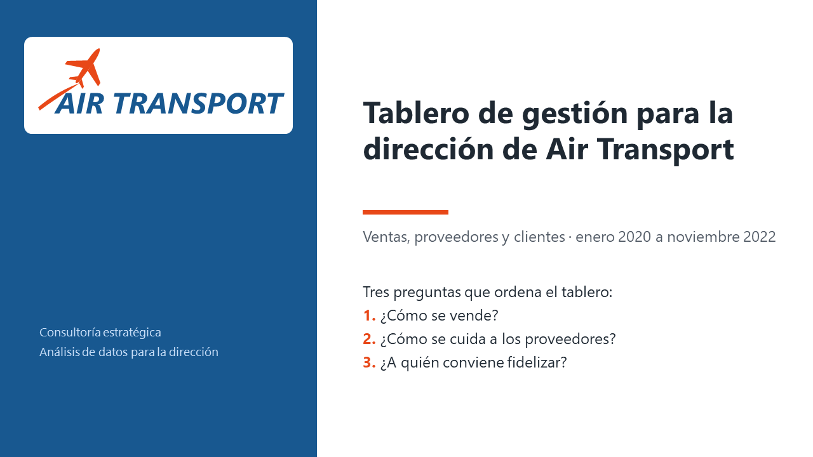
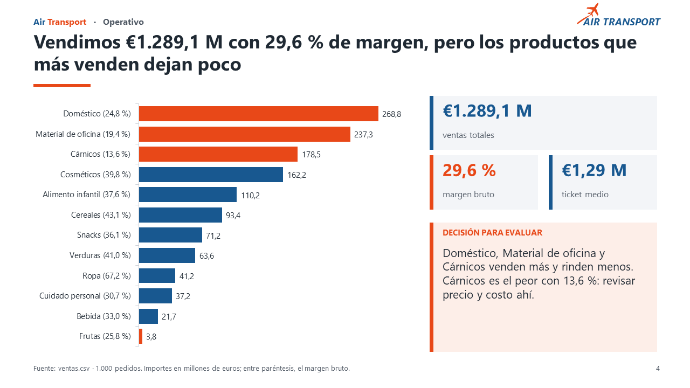
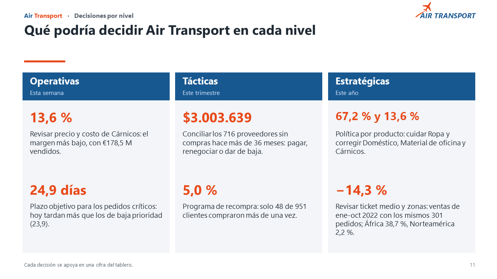
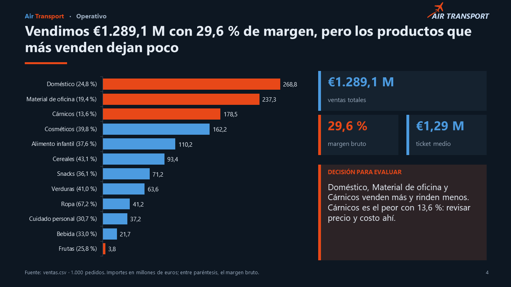
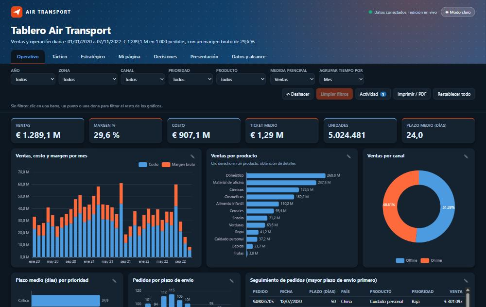
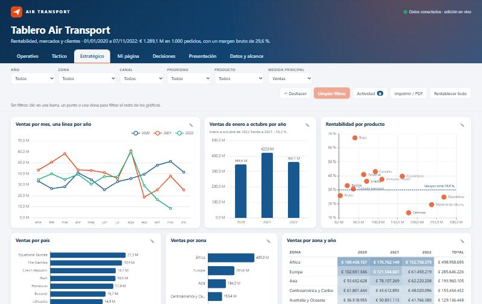
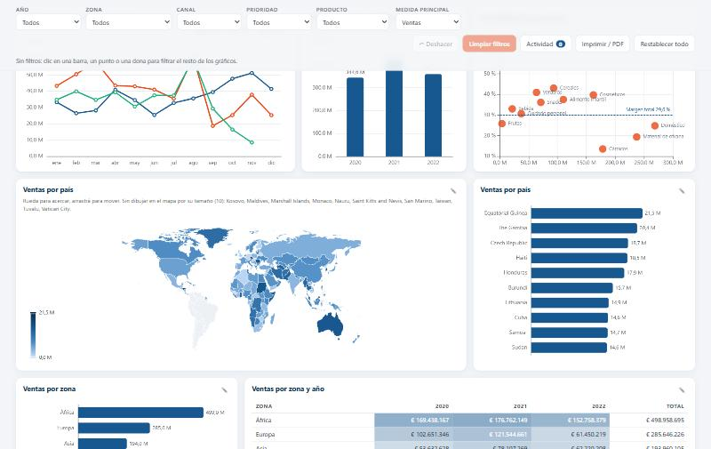

# Tablero Air Transport

[← Todos los proyectos](../README.md)

Tablero de gestión para la dirección de **Air Transport** (caso de consultoría con datos provistos para el curso, no una empresa real): ventas, proveedores y clientes en tres niveles de decisión (operativo, táctico y estratégico), con presentación incluida.

El trabajo se entrega en tres formatos que comparten las mismas cifras:

| Formato | Dónde | Qué es |
|---|---|---|
| **Presentación** | [`entrega/AirTransport-presentacion.pptx`](entrega/AirTransport-presentacion.pptx) y [versión oscura](entrega/AirTransport-presentacion-oscuro.pptx) | 12 diapositivas con gráficos editables, decisiones por nivel y notas del orador |
| **Proyecto de Power BI** | [`entrega/powerbi/AirTransport.pbip`](entrega/powerbi/) | 4 páginas visibles + detalle de producto (obtención de detalles) + tooltip, modelo con medidas DAX |
| **Tablero web** | [`tablero/Tablero-Air-Transport.html`](tablero/Tablero-Air-Transport.html) | Un solo archivo (2 MB), se abre con doble clic en el navegador y no necesita internet |

> ▶ **[Abrir el tablero en vivo](https://mateovega2912.github.io/Proyectos/tablero-air-transport/tablero/Tablero-Air-Transport.html)** (GitHub Pages). También podés descargar el `.html` y abrirlo sin internet: en GitHub se ve su código, no la página.

## Capturas



| Presentación: operativo | Presentación: decisiones por nivel |
|---|---|
|  |  |

| Presentación en modo oscuro | Tablero web en modo oscuro |
|---|---|
|  |  |

| Tablero web: estratégico | Tablero web: ventas por país en un mapa |
|---|---|
|  |  |

## Qué encontré en los datos

Todas las cifras salen de los CSV de [`datos/`](datos/) y se comprueban automáticamente antes de armar la presentación (`entrega/cifras.py`).

- **Ventas:** € 1.289,1 M en 1.000 pedidos, margen bruto de 29,6 % y ticket medio de € 1,29 M.
- **Productos que venden más y rinden menos:** Doméstico, Material de oficina y Cárnicos son los tres mayores y tienen margen por debajo del 30 %; Cárnicos rinde 13,6 % sobre € 178,5 M. Ropa tiene el mejor margen (67,2 %) pero vende solo € 41,2 M.
- **Tendencia:** de enero a octubre, 2022 cae 14,3 % frente a 2021 (€ 360,1 M contra € 420,0 M) **con los mismos 301 pedidos**: baja el importe por pedido, no la cantidad.
- **Proveedores:** 901 de 999 no tuvieron compras en los 12 meses previos a la última fecha del archivo y concentran el 90,5 % del saldo pendiente ($ 3.862.352).
- **Clientes:** de 951 clientes con compras, solo 48 (5,0 %) pidieron más de una vez.
- **Geografía:** África concentra el 38,7 % de las ventas y Norteamérica el 2,2 %; hay 184 países y los 10 primeros suman 13,3 %.

## Qué tiene el tablero web

- **Todo enlazado:** un clic en un gráfico filtra el resto; los filtros activos se ven y se quitan con una ×. Hay una *medida principal* (ventas, margen, pedidos o unidades) que cambia todos los gráficos enlazados.
- **Agrupar el tiempo** por día, semana, mes, trimestre, semestre o año.
- **Editar cada gráfico** (medida, dimensión, tipo, orden, ancho y alto) y **armar una página propia** agregando, moviendo y quitando gráficos. Deshacer y bitácora de cambios.
- **Obtención de detalles** (clic derecho sobre un producto), **mapa coroplético** de ventas por país y tooltips con ventas, margen y pedidos.
- **Decisiones por nivel** y la **presentación** integradas, con cifras calculadas de los datos.
- **Modo claro y oscuro**, **descarga de CSV en un solo ZIP** e impresión a PDF.

El detalle de uso está en [`tablero/LEEME.md`](tablero/LEEME.md) y el del proyecto de Power BI en [`entrega/LEEME.md`](entrega/LEEME.md).

## Límites de los datos

Declararlos importa tanto como los gráficos:

1. Ventas y clientes **no se cruzan**: ninguno de los 951 IDs de cliente de las ventas está en el archivo de clientes. Por eso no hay relación entre esas tablas y los filtros de ventas no se aplican a los gráficos de clientes.
2. Las ventas no traen identificador de proveedor.
3. Las ventas están en euros y los saldos de proveedores en dólares, sin conversión.
4. Noviembre de 2022 está incompleto (último pedido el 7/11/2022).
5. Los meses sin compra de proveedores se miden contra la última compra del archivo, no contra hoy.
6. El país de cada cliente se infiere del formato de la dirección.
7. El proyecto de Power BI no incluye el mapa: Azure Maps pide iniciar sesión al abrir la página. El mapa sí está en el tablero web.

## Cómo reproducirlo

```bash
python entrega/cifras.py                  # comprueba las cifras contra los datos de referencia
python entrega/generar_presentacion.py    # arma las dos presentaciones (necesita python-pptx)
python entrega/generar_powerbi.py         # arma el proyecto de Power BI (.pbip)
python tablero/generar_datos.py           # datos del tablero web
python tablero/generar_mapa.py            # mapa del tablero web
python tablero/empaquetar.py              # junta el tablero en un solo .html
node tablero/pruebas.js                   # pruebas del núcleo del tablero (Node)
```

Para abrir el proyecto de Power BI: abrí `entrega/powerbi/AirTransport.pbip`, tocá **Actualizar ahora** y, si te cambiaste de carpeta, ajustá el parámetro `RutaDatos` (los pasos completos están en `entrega/LEEME.md`). Fue validado con la herramienta oficial de Microsoft para informes (0 errores y 0 advertencias) y abierto en Power BI Desktop.

## Estructura

```
datos/                  ventas.csv, proveedores.csv, clientes.csv
entrega/                presentaciones (.pptx), proyecto de Power BI y los scripts que los generan
tablero/                tablero web (HTML + JavaScript, gráficos con Apache ECharts)
referencia/             paleta de colores del caso
docs/capturas/          imágenes de este README
```

## Herramientas

Power BI Desktop, PowerPoint, Python (`python-pptx`) y JavaScript con [Apache ECharts](https://echarts.apache.org/) (licencia Apache 2.0; el mapa del mundo viene del paquete `echarts@4.9.0`). Lo desarrollé con ayuda de un asistente de IA (Claude Code) y revisé las cifras contra los datos.
